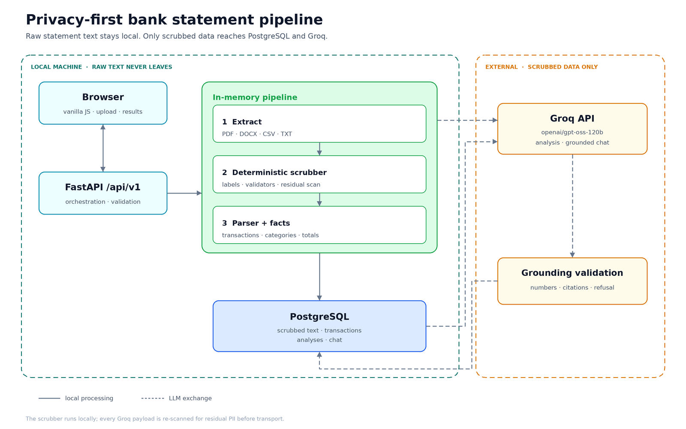

# Bank Statement PII Scrubber

<p>
  
  
  
  
  
  
</p>

A local-first FastAPI service that removes personal and financial identifiers from bank statements **before any text leaves the machine**, stores the scrubbed data in PostgreSQL, and uses a Groq-hosted LLM for budgeting analysis and grounded chat.

**Repository:** <https://github.com/MRoshaan/bank-statement-pii-scrubber>  
**Design notes:** [`NOTES.md`](NOTES.md) · **Guardrails:** [`docs/GUARDRAILS.md`](docs/GUARDRAILS.md)

---

## Contents

- [At a glance](#at-a-glance)
- [Why this exists](#why-this-exists)
- [Privacy invariants](#privacy-invariants)
- [Architecture](#architecture)
- [What is removed vs kept](#what-is-removed-vs-kept)
- [Quick start](#quick-start)
- [Usage](#usage)
- [API](#api)
- [Database schema](#database-schema)
- [Scrubbing approach](#scrubbing-approach)
- [Groq analysis and chat](#groq-analysis-and-chat)
- [Guardrails](#guardrails)
- [Testing](#testing)
- [Known limitations](#known-limitations)
- [Project layout](#project-layout)
- [Example questions](#example-questions)
- [License](#license)

## At a glance

| | |
|---|---|
| **Input** | PDF, DOCX, CSV, TXT, plus ZIP uploads from any folder |
| **Output** | one combined scrubbed string with `---- File: <name> ----` headers, per-file output, redaction report |
| **Privacy boundary** | raw text is never written to PostgreSQL and never sent to Groq; every LLM payload is re-scanned before transport |
| **Storage** | PostgreSQL 16 (scrubbed text, transactions, redactions, analyses, chat) |
| **Model** | Groq `openai/gpt-oss-120b`, fallback `openai/gpt-oss-20b` |
| **Frontend** | vanilla HTML / CSS / JavaScript |
| **Verification** | 59 pytest tests, `ruff` clean |

## Why this exists

Bank statements contain the data an LLM needs for budgeting analysis. They also contain the data that must not leave the user's machine. This service separates the two:

1. Raw files are extracted and scrubbed **in memory**.
2. A deterministic local engine replaces identifiers with placeholders.
3. Only scrubbed text and deterministic facts are stored and sent to Groq.
4. Every Groq payload passes a residual-PII scan immediately before the call.
5. Chat questions are scrubbed before they are stored or sent.

Raw statement text is never persisted and never transmitted.

## Privacy invariants

These are enforced in code:

1. Raw statement text is never written to PostgreSQL.
2. Raw text is never sent to Groq or any external service.
3. The scrubber runs locally and deterministically.
4. Every Groq payload passes `scan_residual()` immediately before the call.
5. User chat messages are scrubbed before storage and transport.
6. Model output is scrubbed and scanned before it is stored or shown.
7. Redaction rows store the entity type, placeholder, and count. The original value is never stored.

## Architecture



**Local machine.** The browser uploads files to FastAPI. Extraction, scrubbing, transaction parsing, and fact computation happen in memory. PostgreSQL stores the scrubbed text and structured rows; there is no raw-statement column.

**External.** Groq receives two bounded payloads:

- **Analysis:** compact FACTS + a 2,000-character scrubbed excerpt + a bounded transaction digest.
- **Chat:** facts + up to 18 retrieved scrubbed rows + the bounded analysis narrative + recent history.

Every model response is validated before it is shown: numeric claims must match deterministic facts, citations must resolve to real transactions, and failures trigger one repair retry followed by a deterministic answer or an explicit refusal.

## What is removed vs kept

| Removed → placeholder | Kept |
|---|---|
| IBANs and bank account numbers (`<IBAN>`, `<ACCOUNT_NUMBER>`) | Person names (account holder and counterparties) |
| Full card numbers (masked last-4 `xxxx2070` stays) | Merchant names, including URL-like ones (`Netflix.com`, `TESCO STORES`) |
| CNIC, SSN, SIN, UK NI, PAN, Aadhaar, tax IDs | Dates and times |
| Emails, phone numbers, UPI/payment handles, wallet IDs | Amounts, balances, currencies |
| Routing, sort, SWIFT/BIC, IFSC, MICR, transit identifiers | Transaction types and descriptions (minus identifiers) |
| Long reference, trace, transaction, invoice, order, consumer, statement IDs | Categories and derived facts |
| Home/customer addresses and IP addresses | |

The balance is the hard part: remove every identifier without destroying the transaction's meaning. A scrubber that deletes `Netflix.com` as a "URL" is as much a failure as one that leaks an IBAN.

## Quick start

### Prerequisites

- Python 3.12+
- Docker (for PostgreSQL 16)
- A Groq API key from [console.groq.com](https://console.groq.com)

### 1. Install

```bash
git clone https://github.com/MRoshaan/bank-statement-pii-scrubber.git
cd bank-statement-pii-scrubber
python3 -m venv .venv
.venv/bin/pip install -r requirements.txt
cp .env.example .env
```

Set `GROQ_API_KEY` in `.env`. The key is never committed.

### 2. Start PostgreSQL

The development host does not have the Docker Compose plugin, so the tested command is `docker run`:

```bash
docker run --name pj-bank-db \
  -e POSTGRES_USER=pjbank \
  -e POSTGRES_PASSWORD=pjbank_dev_password \
  -e POSTGRES_DB=pjbank \
  -p 5432:5432 \
  -v pjbank_pgdata:/var/lib/postgresql/data \
  -d postgres:16
```

A `docker-compose.yml` is included for environments that have Compose.

Create the test database and tables (tests use `TEST_DATABASE_URL`, which must end in `_test`):

```bash
docker exec pj-bank-db psql -U pjbank -d postgres -c "CREATE DATABASE pjbank_test;" || true
.venv/bin/python scripts/init_db.py
```

### 3. Run

```bash
.venv/bin/uvicorn app.main:app --host 127.0.0.1 --port 8000
```

Open <http://127.0.0.1:8000/>. Interactive API docs: <http://127.0.0.1:8000/docs>.

## Usage

### Web UI

1. Drop your PDF, DOCX, CSV, or TXT files into the uploader.
2. Click **Scrub & store**.
3. Inspect the combined output, per-file output, and redaction table.
4. Click **Generate analysis**.
5. Ask follow-up questions in the chat.

### CLI: folder in, one string out

Put your statements in a local folder, for example `data/` (it is gitignored), then:

```bash
.venv/bin/python -m app.cli scrub data --out outputs --name "April statements" --store
```

```text
outputs/scrubbed_combined.txt      # one combined string with per-file headers
outputs/per_file/*.scrubbed.txt    # per-file scrubbed output
outputs/redaction_report.json      # counts/types, no original values
outputs/transactions.json
outputs/facts.json
outputs/metadata.json
```

`--store` persists the batch to PostgreSQL. Omit it to generate files only.

## API

| Method | Path | Purpose |
|---|---|---|
| `POST` | `/api/v1/batches` | Multipart upload; scrub, parse, store |
| `GET` | `/api/v1/batches` | Recent batches |
| `GET` | `/api/v1/batches/{id}` | Batch detail |
| `GET` | `/api/v1/batches/{id}/scrubbed` | Combined scrubbed text download |
| `GET` | `/api/v1/batches/{id}/transactions` | Filter by category or merchant |
| `POST` | `/api/v1/batches/{id}/analyze` | Generate Groq analysis |
| `GET` | `/api/v1/batches/{id}/analysis` | Latest analysis |
| `POST` | `/api/v1/batches/{id}/chat` | Grounded chat |
| `GET` | `/api/v1/batches/{id}/chat/sessions` | Recent sessions |
| `GET` | `/api/v1/batches/{id}/chat/sessions/{sid}` | Chat history |
| `DELETE` | `/api/v1/batches/{id}` | Delete a batch and its dependent rows |
| `GET` | `/api/v1/health` | Database and Groq configuration |

```bash
curl -X POST http://127.0.0.1:8000/api/v1/batches \
  -F "name=April statements" \
  -F "files=@data/wallet_transactions.csv"
```

Design rationale is in [`NOTES.md`](NOTES.md); the schema is in [`schema.sql`](schema.sql).

## Database schema

| Table | Purpose |
|---|---|
| `batches` | One upload run: combined scrubbed text, counts, facts, warnings |
| `statement_files` | Per-file scrubbed text, hash, format, counts, warnings |
| `redactions` | Entity type + placeholder + count (never original values) |
| `transactions` | Date, time, description, merchant, category, signed amount, currency, balance, source line |
| `analyses` | Model, prompt version, JSON result, markdown, grounding report, usage |
| `chat_sessions` | Conversation per batch |
| `chat_messages` | User/assistant turns, citations, grounding metadata |

All tables use UUID primary keys and cascade deletes. Foreign keys and lookup columns are indexed. Amounts use `NUMERIC(18,2)`, not floats.

**Why this schema:**

- Normalizing files and transactions makes per-file output, filtering, and deterministic aggregation possible.
- `transactions` is the source of truth for analysis and chat; the LLM never computes totals.
- Analyses are stored per run, so a later model or prompt version does not overwrite history.
- Chat messages keep citations and grounding metadata for auditability.
- There is no raw-statement column.

## Scrubbing approach

The scrubber is a local, span-based rule engine. It combines labeled field detection, format validation, and context checks, then resolves overlapping spans by priority before replacing them. This avoids the classic failure where one regex corrupts another rule's placeholder.

Key decisions:

- **No Presidio, spaCy NER, scrubadub, or LLM in the scrubbing path.** They over-redact person names, which this project preserves, and add nondeterminism or heavy model dependencies.
- **Validators do the precision work.** IBAN mod-97, Luhn cards, `phonenumbers` for international formats, date/timestamp exclusions, amount-context exclusions.
- **Precision guard.** Merchant URLs (`Netflix.com`, `Amazon.co.uk`) stay; only emails and payment handles are removed.
- **Fail closed.** A high-confidence residual scanner runs after scrubbing. If it finds PII, the batch is blocked before any LLM call.
- **Idempotent placeholders.** Scrubbing an already-scrubbed file does not change it.

## Groq analysis and chat

- **Model:** `openai/gpt-oss-120b`, with `openai/gpt-oss-20b` as fallback. Chosen for JSON output, reasoning capability, a 131,072-token context, and roughly 500 tokens/sec on Groq.
- **Analysis output:** structured JSON with summary, insights, anomalies, recommendations, and data-quality notes.
- **Facts are the only source of truth for numbers.** Python computes every total, ranking, and count; the model writes narrative only.
- **Validation:** numeric values are checked against known facts and transactions; invalid citations are filtered or re-grounded; unsupported numbers trigger one repair retry, then a deterministic fallback.
- **Chat:** retrieval over scrubbed rows plus facts, bounded history, and the same citation/number validation.
- **Prompt injection:** statement text and retrieved rows are delimited and treated as untrusted data, never as instructions.
- **Budget:** the free tier allows 8K TPM, so analysis sends a compact facts pack, a 2K-character excerpt, and a bounded digest rather than the entire combined string.

## Guardrails

The guardrails cover three failure modes: identifiers leaving the machine, the model inventing numbers, and the model following instructions hidden in statement text.

- **Before transport.** Chat questions are scrubbed locally, and every Groq payload passes `scan_residual()`. A hit blocks the call.
- **After generation.** Model strings are scrubbed and re-scanned before validation, storage, or display.
- **Numbers.** Every numeric claim must match a value in the deterministic facts or the retrieved transactions.
- **Citations.** Every citation must resolve to a real `filename:line` ref; invalid refs are dropped or re-grounded to matching rows.
- **Repair, then refuse.** Failed validation gets one repair retry, then a deterministic answer for common aggregates or an explicit refusal.
- **Prompt injection.** Statement text and retrieved rows are delimited as data. Instructions inside them are ignored.
- **Tests.** 59 pytest tests cover leaks, preservation, injection attempts, numeric validation, and refusal paths. See [`docs/GUARDRAILS.md`](docs/GUARDRAILS.md).

## Testing

```bash
.venv/bin/pytest -q
.venv/bin/ruff check app tests
```

The suite covers:

- all four sample formats and the combined output
- known-PII absence and merchant/amount/date preservation
- idempotence, masked cards, merchant URLs
- transaction parsing, Indian/German number formats, PayPal totals
- API upload → database → analysis → chat
- prompt injection, residual-PII blocking, numeric/citation validation
- model-output PII, complete-prompt scanning, grounding fallback, empty analyses
- ZIP expansion limits, duplicate filenames, metadata scrubbing, negative balances

## Known limitations

- Scanned PDFs without a text layer are not OCR'd; the file is flagged with a warning.
- Addresses are label-driven (`Address:`, `Anschrift:`, etc.). An unlabeled free-text address may survive.
- Very unusual national-ID formats or statement layouts may need a new labeled rule.
- Multi-currency statements are reported per currency; there is no FX conversion.
- The transaction parser covers the sample layouts and common variants, not every bank's format.
- The free Groq tier has an 8K TPM limit, so analysis uses a compact facts pack, a 2K-character scrubbed excerpt, and a bounded transaction digest.
- Person names are retained by design because they carry analytical value. Chat may therefore mention a counterparty by name; identifier values are never sent and cannot be reconstructed.
- Numeric membership cannot prove every sentence's meaning or every date claim; it proves that every number shown came from the data.

## Project layout

```text
app/                  FastAPI app, scrubber, parser, facts, Groq clients
frontend/             vanilla HTML/CSS/JS
tests/                pytest suite
outputs/              scrubbed output and reports
docs/                 architecture, guardrails, engineering notes
scripts/init_db.py    create tables
AGENTS.md             engineering rules and privacy invariants
schema.sql            PostgreSQL DDL
```

## Example questions

Run the app, upload a set of statements, inspect the combined and per-file output, query PostgreSQL, generate the analysis, and ask:

- "How much did I spend on food?"
- "Which merchant did I pay most often?"
- "What were my largest cash withdrawals?"

The free tier allows 8K TPM, so leave a short gap between the analysis and chat calls. The UI labels deterministic fallbacks when the provider is rate-limited.

## License

MIT. See [`LICENSE`](LICENSE).
